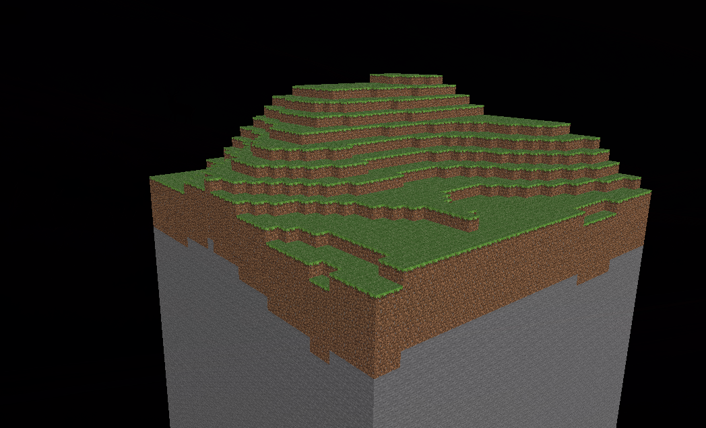

# Minecraft Clone

A Minecraft-inspired project made from scratch in C++ and OpenGL. For now, it renders a textured block that you can fly around and look at.



## Build and run

You need a C++17 compiler, CMake 3.15 or newer, and a graphics driver supporting OpenGL 4.6, `GL_ARB_bindless_texture`, and `GL_NV_gpu_shader5`. GLFW also needs its platform development libraries.

```sh
cmake -S . -B build
cmake --build build
./build/mygame
```

Press Escape to close the application. The current build uses an absolute path to `resources/`, so update the resource path in `CMakeLists.txt` and rebuild if you move or distribute the project.
